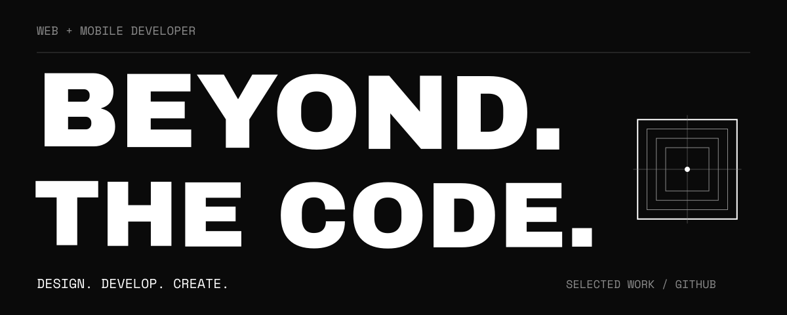
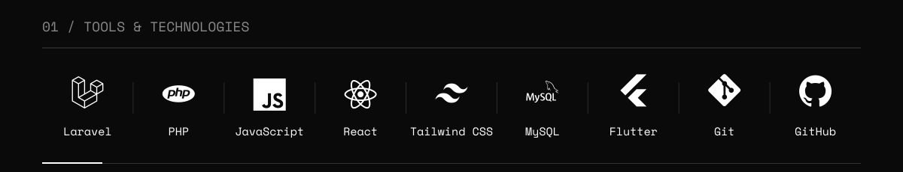
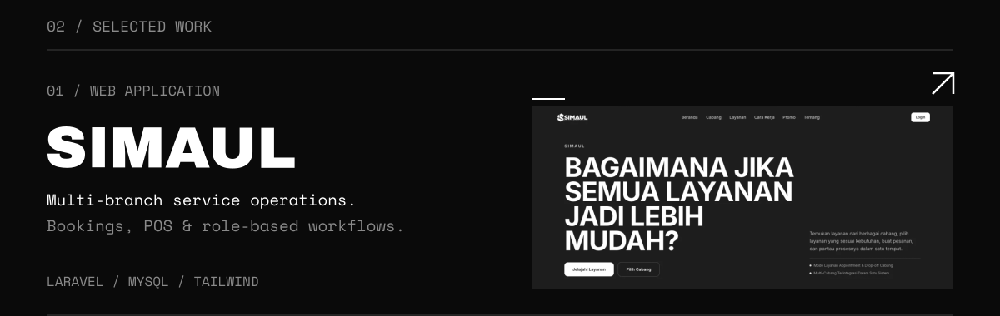
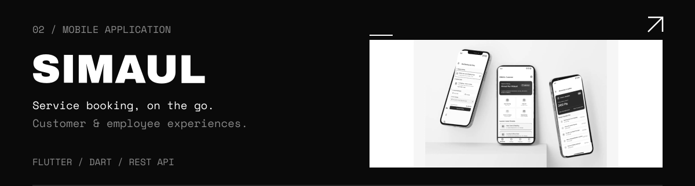
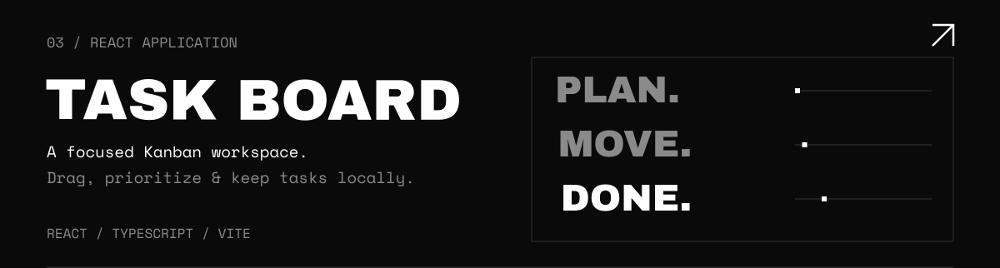
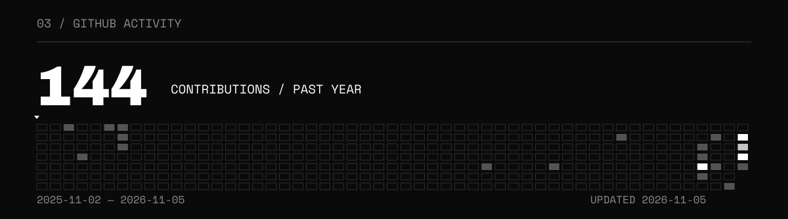
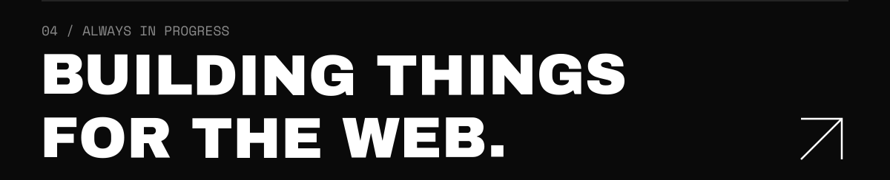

[← Back to animated profile](../README.md)

<a href="https://ahmadnurhidayat.vercel.app/">
<picture>
  <source media="(max-width: 900px)" srcset="../assets/motion/hero-beyond-mobile.svg">
  
</picture>
</a>

<picture>
  <source media="(max-width: 900px)" srcset="../assets/motion/technologies-mobile.svg">
  
</picture>

<a href="https://github.com/AhmadNurHidayat-23/sistem-manajement-usaha-layanan-web">
<picture>
  <source media="(max-width: 900px)" srcset="../assets/motion/simaul-web-mobile.svg">
  
</picture>
</a>

<a href="https://github.com/AhmadNurHidayat-23/sistem-manajement-usaha-layanan-mobile">
<picture>
  <source media="(max-width: 900px)" srcset="../assets/motion/simaul-mobile-mobile.svg">
  
</picture>
</a>

<a href="https://github.com/AhmadNurHidayat-23/task-board">
<picture>
  <source media="(max-width: 900px)" srcset="../assets/motion/task-board-mobile.svg">
  
</picture>
</a>

<a href="https://github.com/AhmadNurHidayat-23?tab=overview#contributions">
<picture>
  <source media="(max-width: 900px)" srcset="../assets/motion/activity-mobile.svg">
  
</picture>
</a>

<a href="https://ahmadnurhidayat.vercel.app/">
<picture>
  <source media="(max-width: 900px)" srcset="../assets/motion/footer-mobile.svg">
  
</picture>
</a>

  <a href="https://github.com/AhmadNurHidayat-23">GitHub ↗</a> &nbsp; / &nbsp;
  <a href="https://www.linkedin.com/in/ahmad-nur-hidayat-071169414/">LinkedIn ↗</a> &nbsp; / &nbsp;
  <a href="https://ahmadnurhidayat.vercel.app/">Portfolio ↗</a>

