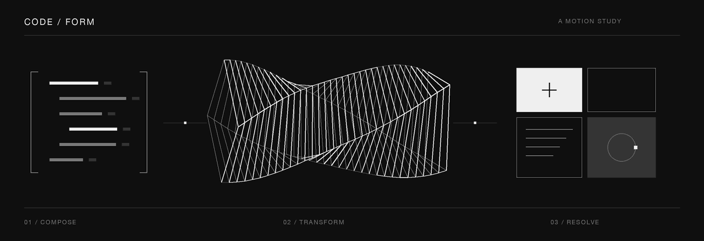

  

## 01 / Selected work

| Project | What it explores | Built with |
| :--- | :--- | :--- |
| [SIMAUL](https://github.com/AhmadNurHidayat-23/sistem-manajement-usaha-layanan-web) | Multi-branch service operations: bookings, queues, point of sale, inventory, and role-based workflows. | Laravel · Blade · MySQL |
| [Taskly](https://github.com/AhmadNurHidayat-23/taskly-sistem-manajemen-tugas) | Task management with priorities, deadlines, and filters; Docker images published through GitHub Actions. | Laravel · SQLite · Docker |
| [Task Board](https://github.com/AhmadNurHidayat-23/task-board) | A Kanban board with drag-and-drop ordering and browser-local persistence. | React · TypeScript · Vite |
| [Notes](https://github.com/AhmadNurHidayat-23/notes) | A Markdown workspace with autosave, tags, preview, and file import/export. | Next.js · React · TypeScript |
| [Webhook Delivery](https://github.com/AhmadNurHidayat-23/webhook-delivery) | Queued webhook delivery with HMAC signatures, bounded retries, and attempt logs. | Laravel · SQLite · Queues |
| [Live Chat](https://github.com/AhmadNurHidayat-23/live-chat) | Room-based messaging with presence, typing indicators, and temporary in-memory history. | Node.js · Express · Socket.IO |

[Browse all repositories →](https://github.com/AhmadNurHidayat-23?tab=repositories)

## 02 / Toolkit

**Backend** — PHP, Laravel, Node.js, Express, MySQL, SQLite  
**Frontend** — React, Next.js, TypeScript, JavaScript, Blade, HTML, CSS, Tailwind CSS  
**Development** — Git, GitHub Actions, Docker, Vite, PHPUnit

## 03 / Focus

I am interested in Laravel application design, React interfaces, and reliable data flows. The repositories above include setup instructions and describe each project's scope and current limitations.

For a conversation about web development or a specific project, [connect on LinkedIn](https://www.linkedin.com/in/ahmad-nur-hidayat-071169414/) or [send an email](mailto:nurhidayata062.stu@pnc.ac.id).
